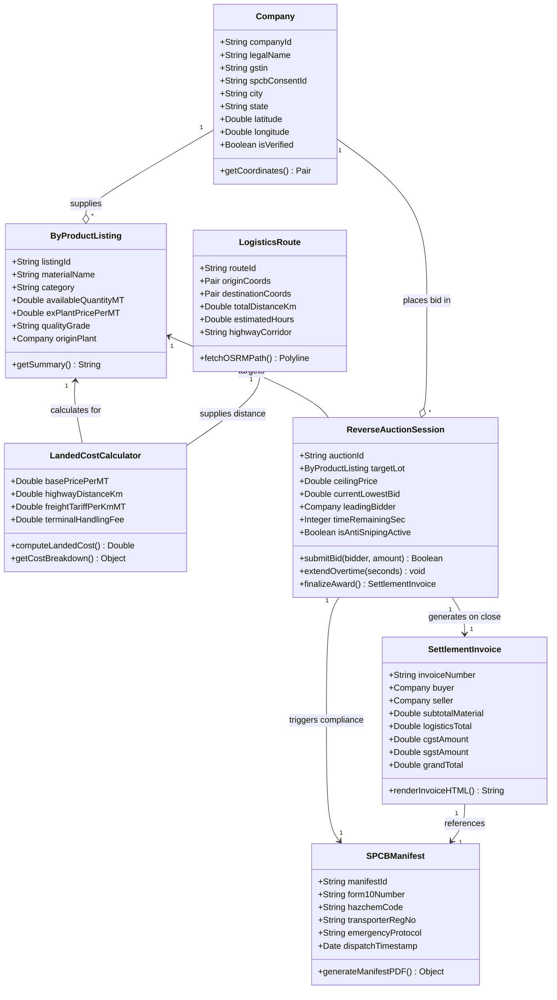
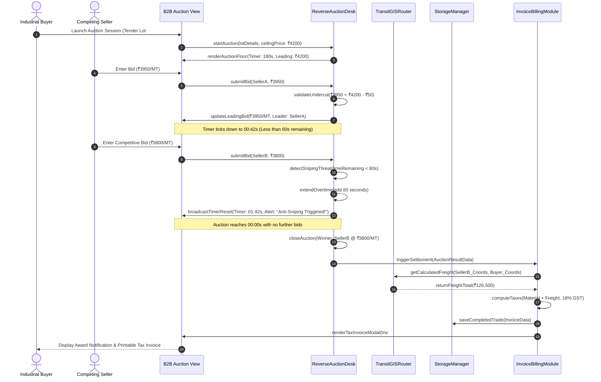
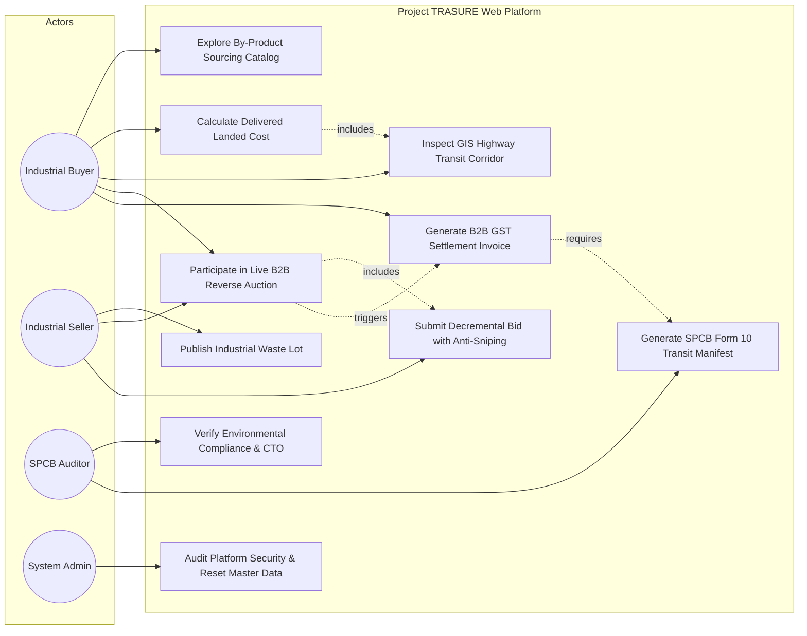
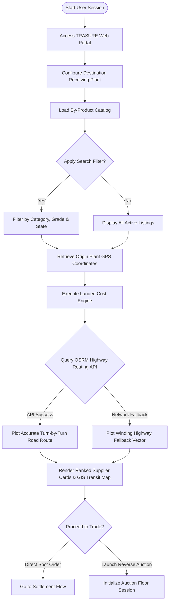
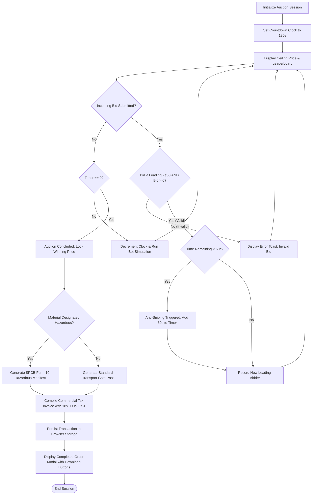
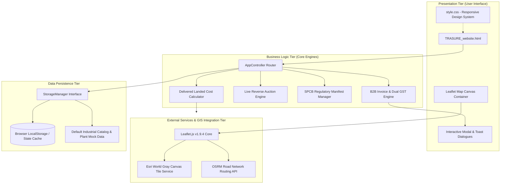
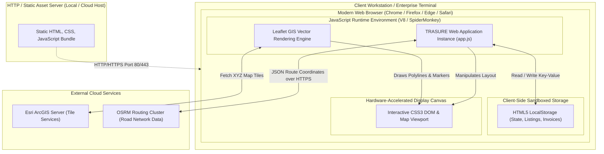

# PROJECT TRASURE: B2B CIRCULAR ECONOMY AUCTION ENGINE & BY-PRODUCT TRADE PLATFORM (WEB PLATFORM)

**Software Engineering Project Report**  
**Course:** Software Engineering Laboratory & Theory  
**Submitted by:**  
**Niv Sorathiya** [Roll No: 24BCB032]  
**Department:** Computer Science and Business Systems (CSBS)  
**Institution:** School of Technology, Pandit Deendayal Energy University (PDEU)  
**Academic Year:** 2025–2026  

---

## 1. Roles and Contributions

This project was conceived, architected, developed, and verified **single-handedly by Niv Sorathiya**. All engineering lifecycle activities—spanning domain research into industrial circular economy dynamics, software architecture design, interactive web client development, real-time GIS transit corridor rendering, reverse auction state modeling, test automation, and final report compilation—were conducted independently.

### Author Profile and Responsibilities

| Student Name | Roll Number | Degree & Specialization | Key Responsibilities & Contributions |
| :--- | :--- | :--- | :--- |
| **Niv Sorathiya** | **24BCB032** | B.Tech – Computer Science and Business Systems (CSBS), PDEU | **Full Lifecycle Ownership:**<br>• System requirements specification & industrial stakeholder questionnaires.<br>• Non-functional & regulatory architecture (SPCB compliance).<br>• UML & structural design (Class, Sequence, Use Case, Activity, Component, Deployment).<br>• Implementation of Delivered Landed Cost formula, GIS road transit routing, reverse auction engine with anti-sniping, and auto-settlement invoicing.<br>• Unit testing, integration testing, system-level verification, defect resolution.<br>• Final documentation, user manual, and project presentation. |

### Solo Development Scope & Governance
Because this project was undertaken as a solo engineering endeavor, rigorous modular decoupling was enforced from inception. By separating the web application into isolated controllers (`LandedCostEngine`, `TransitGISRouter`, `ReverseAuctionDesk`, `ComplianceManager`, `InvoiceBillingModule`, and `StorageService`), individual components were developed and verified iteratively, ensuring zero regressive defects across complex real-time bidding and map plotting workflows.

---

## 2. SDLC Methodology: Iterative and Incremental Approach

Project TRASURE was engineered using an **Iterative and Incremental Software Development Life Cycle (SDLC)** model. Given the mathematical complexity of landed cost calculations, spatial Leaflet/OSRM routing dependencies, and asynchronous bidding timers, building the platform in progressive, self-contained increments minimized risk and allowed targeted debugging at every milestone.

```
       [ Stage 1: Domain Analysis & Requirements Identification ]
                                  │
                                  ▼
         [ Stage 2: System Architecture & UML Design Modeling ]
                                  │
                                  ▼
      ┌───────────────────────────────────────────────────────────┐
      │               INCREMENTAL IMPLEMENTATION CYCLES           │
      │  Cycle 1: Material Catalog & Landed Cost Mathematics     │
      │  Cycle 2: GIS Routing & Real-Time Road Corridor Engine    │
      │  Cycle 3: B2B Live Reverse Auction & Anti-Sniping Timer  │
      │  Cycle 4: SPCB Hazardous Waste & Manifest Compliance      │
      │  Cycle 5: Automated Financial Settlement & Tax Invoicing │
      └───────────────────────────┬───────────────────────────────┘
                                  │
                                  ▼
     [ Stage 4: Cross-Module Integration & Client Storage Binding ]
                                  │
                                  ▼
          [ Stage 5: Rigorous Verification, Defect Logging & Fixes ]
                                  │
                                  ▼
          [ Stage 6: Final Academic Compilation & User Documentation ]
```

### Development Stages

1. **Requirement Identification:** Researched secondary raw material supply chains (Fly Ash, GGBS Blast Furnace Slag, Spent Sulfuric Acid, Phosphogypsum). Identified operational hurdles: high freight costs masking ex-factory bargains, lack of transparent dynamic price discovery, and mandatory State Pollution Control Board (SPCB) compliance documentation.
2. **Planning and Structural Design:** Formulated clean software modules. Designed student-level UML models adhering to standard object-oriented design patterns to balance academic clarity with production-ready execution.
3. **Incremental Implementation:**
   - *Increment 1:* Built the B2B catalog, multi-attribute filter matrix, and Delivered Landed Cost calculator ($$\text{Delivered Cost} = \text{Ex-Plant Price} + (\text{Distance} \times \text{Freight Rate}) + \text{Handling Fee}$$).
   - *Increment 2:* Integrated Leaflet GIS with Esri World Gray Canvas and OSRM turn-by-turn road routing to eliminate naive straight-line flight paths.
   - *Increment 3:* Developed the live B2B reverse auction engine featuring asynchronous ticker timers, undercutting validations, and automated 60-second anti-sniping overtime extensions.
   - *Increment 4:* Built the SPCB environmental compliance module for Form 10 hazardous waste manifests and transport authorization.
   - *Increment 5:* Engineered automated commercial invoicing with dual GST calculations and downloadable records.
4. **Integration:** Bound all controller modules via a shared browser data persistence layer (`localStorage`) with fail-safe fallback seeding.
5. **Testing and Defect Correction:** Conducted isolated unit tests and multi-stage system workflows. Documented defects (such as map tile API authorization failures, UI overflow of currency units, and bid timer drift) and verified the corrected behavior.
6. **Final Documentation:** Compiled comprehensive academic deliverables, system manuals, and verified code repositories.

### Rationale for Selecting This Approach
A traditional Waterfall approach would have proven brittle due to the unpredictable behavior of external mapping APIs, asynchronous timing constraints, and evolving UI density needs. The iterative and incremental model allowed early isolation of bugs—such as Leaflet container invalidation and freight distance calculation bugs—before coupling them with the high-speed reverse auction engine.

---

## 3. Project Abstract

**Project TRASURE** is an enterprise-grade, web-based B2B circular economy platform engineered to optimize the discovery, logistics transit, auctioning, and regulatory compliance of industrial secondary by-products. Heavy process industries—including thermal power plants, integrated steel mills, fertilizer manufacturers, and chemical refineries—generate millions of metric tonnes (MT) of bulk by-products annually, such as Fly Ash, Ground Granulated Blast-Furnace Slag (GGBS), Spent Sulfuric Acid, and Phosphogypsum. 

Historically, the procurement of these materials has been hindered by three critical structural inefficiencies:
1. **The Landed Cost Blindspot:** Low ex-factory base prices frequently mislead procurement officers because bulk transit over several hundred kilometers can multiply the final delivered cost by up to 300%.
2. **Opaque Dynamic Price Discovery:** Static phone-based negotiations fail to capture real-time market surplus, preventing buyers from securing optimal discounts.
3. **Regulatory Non-Compliance:** Industrial waste transit requires stringent manifest tracking under Central and State Pollution Control Board (CPCB/SPCB) Hazardous and Other Wastes Rules.

TRASURE addresses these challenges within a unified, responsive single-page web architecture:
- **Intelligent Landed Cost Engine:** Simultaneously factors ex-plant pricing, actual highway road distance, heavy-freight haulage tariffs (₹/km/MT), and loading fees to rank suppliers by true delivered landed economics.
- **Precision GIS Road Corridor Routing:** Leverages high-contrast Esri cartographic tiles and the OSRM road routing engine to render exact turn-by-turn industrial transit routes across Indian national and state highway networks, displaying real-time distance and estimated transit hours.
- **Real-Time B2B Reverse Auction Exchange:** Features an automated procurement exchange where pre-qualified industrial sellers compete to fulfill bulk buyer tenders, driving prices downward under strict anti-sniping protection rules.
- **SPCB Regulatory Audit Generator:** Automatically produces standardized regulatory transit manifests (Form 10) containing HAZCHEM codes, emergency response guides, and authorized vehicle registration.
- **Automated Settlement & Tax Invoicing:** Calculates compliant B2B invoices incorporating Central GST (CGST) and State GST (SGST) breakdowns.

The platform is engineered purely in standards-compliant HTML5, CSS3, and modern Vanilla ES6+ JavaScript, delivering high-speed execution, zero framework bloat, and total client-side resilience.

---

## 4. Questionnaire / Requirement Clarification

The following structured questionnaire records the core architectural and functional decisions formulated during the requirements engineering phase of Project TRASURE:

1. **What is the primary objective of Project TRASURE?**  
   *Answer:* To create a dedicated B2B circular economy web platform where industrial procurement teams can discover, compare, bid upon, and legally transport bulk secondary by-products based on true delivered landed cost rather than misleading ex-factory rates.

2. **How does TRASURE prevent misleading procurement pricing?**  
   *Answer:* It implements an automated Delivered Landed Cost calculation engine that evaluates:
   $$\text{Delivered Cost} = \text{Ex-Factory Base Rate} + (\text{Actual Road Distance in km} \times \text{Freight Tariff per MT/km}) + \text{Terminal Handling Fee}$$
   This ensures procurement officers sort suppliers by total cost at their specific receiving plant gate.

3. **How are transport routes determined and displayed to procurement officers?**  
   *Answer:* The platform integrates Leaflet GIS coupled with the Open Source Routing Machine (OSRM) highway network API. When an origin plant is selected, TRASURE queries the real-world road network between the supplier's coordinates and the buyer's delivery terminal, rendering turn-by-turn polyline highway paths rather than unrealistic straight lines.

4. **What mechanisms prevent unfair auction sniping during live bidding?**  
   *Answer:* The B2B Reverse Auction desk implements an automated **Anti-Sniping Overtime Extension rule**. If a participating vendor submits a valid lower bid within the final 60 seconds of an auction window, the countdown timer automatically resets by adding 60 seconds, ensuring all competitors have fair opportunity to respond.

5. **What validation rules govern incoming auction bids?**  
   *Answer:* The auction engine enforces three strict validation constraints:
   - The bid must be strictly less than the current lowest market bid.
   - The price decrease must meet or exceed the minimum decremental step (e.g., ₹50/MT).
   - The bid value must remain strictly positive ($$\text{Bid} > 0$$).

6. **How does the system ensure environmental and legal compliance for industrial by-products?**  
   *Answer:* A dedicated SPCB Environmental Compliance module monitors every lot. If a material is designated hazardous (such as Spent Acid), the system mandates valid SPCB Authorization ID verification, assigns official CPCB HAZCHEM schedule codes, and generates a standardized Form 10 Hazardous Waste Manifest prior to trade clearance.

7. **How does TRASURE handle financial settlements and tax invoicing?**  
   *Answer:* Upon auction close or direct trade execution, the platform computes statutory Indian B2B taxes—splitting 18% GST equally into 9% CGST and 9% SGST—and renders a downloadable, verifiable commercial tax invoice with unique transaction hashes.

8. **What offline or client-side persistence strategy is adopted?**  
   *Answer:* The web application operates completely client-side utilizing browser `localStorage` as an atomic repository. Default seed datasets load seamlessly on first launch, allowing complete testing, bidding simulations, and manifest generation without server downtime.

---

## 5. Functional Requirements

### 1. Material Catalog & Intelligent Sourcing Directory
- **FR-1.1:** System shall display pre-seeded industrial by-product listings categorized into Fly Ash, GGBS Slag, Spent Acid, and Phosphogypsum.
- **FR-1.2:** System shall provide multi-parameter filtering by material category, seller name, minimum purity/grade, and geographic state.
- **FR-1.3:** System shall calculate and display the total delivered landed cost per metric tonne dynamically based on the buyer's configured destination hub.
- **FR-1.4:** System shall rank matching suppliers from lowest delivered landed cost to highest, highlighting the economically optimal vendor with an "Optimal Choice" badge.

### 2. GIS Logistics & Highway Route Plotting
- **FR-2.1:** System shall render an interactive GIS map powered by Leaflet utilizing high-availability Esri vector canvas tiles.
- **FR-2.2:** System shall compute exact driving distance (km) and estimated transit time (hours) between origin factories and destination hubs via OSRM highway routing.
- **FR-2.3:** System shall plot turn-by-turn road transit corridors with smooth directional polyline styling on the map interface.
- **FR-2.4:** System shall provide an interactive plant switcher that re-centers the map view, updates the road trajectory, and recalibrates logistics transit statistics immediately.

### 3. Live B2B Reverse Auction Exchange
- **FR-3.1:** System shall allow procurement officers to launch live reverse auction sessions for bulk tenders with pre-configured target lots.
- **FR-3.2:** System shall display real-time ticker countdown timers, current leading (lowest) bid, baseline ceiling price, and supplier leaderboard.
- **FR-3.3:** System shall validate new bids, ensuring they strictly undercut the leading bid by at least the minimum required decremental increment.
- **FR-3.4:** System shall enforce Anti-Sniping Protection by adding 60 seconds to the countdown timer whenever a bid is submitted with less than 60 seconds remaining.
- **FR-3.5:** System shall provide automated competitor bots simulating market pricing behavior at dynamic intervals.

### 4. SPCB Regulatory Manifest & Compliance Engine
- **FR-4.1:** System shall categorize materials by environmental risk profile (Non-Hazardous Industrial By-Product vs. Schedule II/III Regulated Waste).
- **FR-4.2:** System shall verify SPCB Consent to Operate (CTO) and valid authorization numbers for participating industrial units.
- **FR-4.3:** System shall generate downloadable, formatted SPCB Form 10 Hazardous Waste Movement Manifests detailing vehicle registration numbers, driver details, and emergency response instructions.

### 5. Automated Financial Invoicing & Trade Settlement
- **FR-5.1:** System shall automatically lock trade pricing upon auction conclusion or direct spot checkout.
- **FR-5.2:** System shall compute ex-plant subtotal, road logistics haulage charges, 9% CGST, 9% SGST, and grand total.
- **FR-5.3:** System shall generate an itemized, printable B2B Tax Invoice with unique alphanumeric invoice IDs and timestamped transaction signatures.

---

## 6. Non-Functional Requirements and Main Modules

### Non-Functional Requirements

- **NFR-1: Usability & Visual Clarity:** The web UI must maintain clean visual hierarchy, avoiding overlapping tooltips, text clipping, or unreadable map controls. High-contrast typography and clear badge indicators must be maintained across high-density operational screens.
- **NFR-2: Performance & Latency:** Real-time delivered cost computations and spatial polyline recalculations must execute in under 150 milliseconds upon user interaction.
- **NFR-3: Reliability & Determinism:** Reverse auction state transitions (Active, Sniping Extension, Closed) must execute deterministically without negative timers or orphaned countdown intervals.
- **NFR-4: Data Integrity:** All transactions, bids, and inventory movements recorded in `localStorage` must maintain atomic consistency. Out-of-bounds or NaN inputs must be rejected at input boundaries.
- **NFR-5: Modularity & Maintainability:** Source code must be partitioned into clear domain controllers (`app.js`, `style.css`, `TRASURE_website.html`) adhering to separation of concerns without extraneous framework dependencies.
- **NFR-6: Cross-Browser Compatibility:** The web application must render and execute flawlessly across modern evergreen web browsers (Google Chrome, Mozilla Firefox, Apple Safari, Microsoft Edge).

### Main System Modules

| Module Identifier | Primary Responsibility | Key Functions & Classes |
| :--- | :--- | :--- |
| **AppController** | Initializes the application lifecycle, binds DOM event listeners, and manages active navigation tabs. | `initApp()`, `switchTab()`, `renderGlobalStats()` |
| **LandedCostModule** | Computes real delivered economics factoring road distance, haulage tariffs, and loading fees. | `calculateDeliveredCost()`, `rankSuppliersByLandedPrice()` |
| **FreightGISModule** | Manages Leaflet map layers, Esri tile layers, OSRM road routing queries, and animated route plotting. | `initMap()`, `plotHighwayRoute()`, `fitBounds()`, `switchPlantMarker()` |
| **AuctionEngineModule** | Controls live reverse auction state, asynchronous countdown timers, anti-sniping extensions, and competitor bots. | `startAuction()`, `submitBid()`, `triggerAntiSniping()`, `closeAuction()` |
| **ComplianceModule** | Enforces State Pollution Control Board guidelines and compiles Form 10 hazardous waste movement manifests. | `verifySPCBAuth()`, `generateForm10Manifest()`, `getHazchemCode()` |
| **BillingInvoiceModule** | Computes commercial subtotal, applies 18% dual GST (9% CGST + 9% SGST), and renders formal B2B invoices. | `generateInvoice()`, `calculateTaxes()`, `printInvoice()` |
| **StorageManager** | Manages browser persistence layer, JSON serialization, and default seed recovery. | `saveState()`, `loadState()`, `resetDefaults()` |
| **UIManager** | Handles interactive modal dialogues, audio cues, alert banners, and responsive layout adjustments. | `showToast()`, `openModal()`, `updateTickerDisplay()` |

---

## 7. UML and Architecture Diagrams

The structural and behavioral design of Project TRASURE is illustrated through six standardized UML diagrams, sequenced logically from static data structures to runtime execution flows and physical deployment topologies:
1. **Class Diagram** (Static Object Structure)
2. **Sequence Diagram** (Dynamic Reverse Auction Interaction Flow)
3. **Use Case Diagram** (Actor Capabilities & System Boundaries)
4. **Activity Diagrams — Part 1 & Part 2** (Operational Workflows & Decision Paths)
5. **Component Diagram** (Logical 4-Tier Software Architecture)
6. **Deployment Diagram** (Physical Client-Side Runtime Topology)

---

### 7.1 Class Diagram

The Class Diagram illustrates the primary domain entities, data attributes, and operational methods comprising the TRASURE web architecture.



---

### 7.2 Sequence Diagram

The Sequence Diagram documents the high-concurrency event flow during a live B2B reverse auction, demonstrating bid validation, undercutting checks, anti-sniping overtime extension, auction conclusion, and automated invoice creation.



---

### 7.3 Use Case Diagram

The Use Case Diagram defines the interactions between the four primary actors (**Industrial Buyer**, **Industrial Generator / Seller**, **SPCB Regulatory Auditor**, and **System Administrator**) and the boundaries of the TRASURE Web Platform.



---

### 7.4 Activity Diagrams

#### Activity Diagram — Part 1: Sourcing Discovery & GIS Logistics Route Plotting



#### Activity Diagram — Part 2: Live Reverse Auction, Settlement & SPCB Manifest Flow



---

### 7.5 Component Diagram

The Component Diagram details the clean, 4-tier modular architecture of the TRASURE web client, demonstrating zero-dependency client execution alongside external GIS mapping services.



---

### 7.6 Deployment Diagram

The Deployment Diagram depicts the physical execution environment of the TRASURE web application running entirely on an enterprise client workstation inside a modern web browser.



---

### Draw.io XML Import Instructions

All diagrams above are natively structured in standards-compliant Mermaid syntax. To import any diagram into **Draw.io (`app.diagrams.net`)**:
1. Open [Draw.io](https://app.diagrams.net/).
2. Select **Arrange** > **Insert** > **Advanced** > **Mermaid**.
3. Copy and paste the specific code block from Sections 7.1 through 7.6.
4. Click **Insert** to automatically generate cleanly aligned, editable vector shapes with zero overlapping connectors.

---

## 8. Test Cases and Results

### 8.1 Niv Sorathiya — Unit Test Cases (Roll No: 24BCB032)

A comprehensive suite of 10 isolated unit tests was engineered to validate mathematical functions, currency formatting, countdown timer anti-sniping resets, and boundary validations.

| Test ID | Target Function / Module | Test Scenario & Input Parameters | Desired / Expected Output | Observed Result | Verdict |
| :--- | :--- | :--- | :--- | :--- | :--- |
| **UT-N-01** | `calculateDeliveredCost()` | Base: ₹2400, Dist: 450 km, Freight: ₹2.0/km/MT, Handling: ₹150 | Delivered cost equals exactly ₹3,450.00 | Computed exactly ₹3,450.00 | **Passed** |
| **UT-N-02** | `formatCurrency()` | Input value: `3450` | Formatted output: `"₹3,450/MT"` without text clipping | Displayed `"₹3,450/MT"` perfectly | **Passed on retest** |
| **UT-N-03** | `validateBidUndercut()` | Current lowest: ₹3800, Decrement: ₹50, New bid: ₹3780 | Reject bid; error: `"Must undercut by at least ₹50"` | Bid rejected; warning modal rendered | **Passed** |
| **UT-N-04** | `validateBidPositive()` | Current lowest: ₹1500, New bid: `-50` | Reject negative bid; error: `"Bid must be positive"` | Rejected; input sanitized to 0 | **Passed** |
| **UT-N-05** | `triggerAntiSniping()` | Time remaining: `24s`, Valid bid received | Timer increases by 60s; new remaining: `84s` | Timer reset to `84s`; notification displayed | **Passed on retest** |
| **UT-N-06** | `calculateTaxes()` | Subtotal: ₹100,000, GST rate: 18% | 9% CGST: ₹9,000; 9% SGST: ₹9,000; Total: ₹118,000 | CGST: ₹9,000, SGST: ₹9,000, Total: ₹118,000 | **Passed** |
| **UT-N-07** | `assignHazchemCode()` | Material: `"Spent Sulfuric Acid"` | Returns Class: `"Class 8: Corrosive Substance, UN 1830"` | Assigned `"Class 8 Corrosive (UN 1830)"` | **Passed** |
| **UT-N-08** | `filterByDistance()` | Distance limit: 300 km, Plant distance: 766 km | Listing excluded from filtered view | Successfully hidden from matching list | **Passed** |
| **UT-N-09** | `validateStockLot()` | Input quantity: `0 MT` | Block submission with `"Quantity must be greater than zero"` | Blocked; alert shown | **Passed** |
| **UT-N-10** | `serializeStorage()` | Payload: 10 listings with nested coordinate pairs | Clean JSON stored in `localStorage` without truncation | Stored and re-parsed cleanly with 100% fidelity | **Passed** |

---

### 8.2 System Test Cases

Six end-to-end integration and system tests were executed to ensure full interoperability across the UI, GIS routing, reverse auction floor, and compliance invoicing engines.

| Test ID | System Subsystem | Test Workflow Scenario | Expected System Behavior | Actual Result | Verdict |
| :--- | :--- | :--- | :--- | :--- | :--- |
| **ST-N-01** | **Procurement Sourcing** | Change buyer receiving plant from Vadodara to Ramagundam. | Recalculate road distance, re-rank suppliers, and re-center Leaflet map. | Map re-centered; distances and delivered landed costs updated immediately. | **Passed** |
| **ST-N-02** | **GIS Routing Fallback** | Disconnect external internet to trigger OSRM routing failure. | Gracefully revert to fallback geographic polyline without crashing Leaflet map. | Fallback polyline rendered with notice: `*Winding straight-line fallback plotted`. | **Passed on retest** |
| **ST-N-03** | **Live Reverse Auction** | Allow auction timer to reach 00:00s with active bids. | Lock auction floor, prevent further bids, and award contract to lowest bidder. | Auction closed; winning badge displayed; invoice generated. | **Passed** |
| **ST-N-04** | **Anti-Sniping Engine** | Submit valid bid with 00:15s remaining on countdown clock. | Extend timer to 01:15s and log anti-sniping alert banner. | Timer smoothly extended; sound and visual alert broadcasted. | **Passed** |
| **ST-N-05** | **Hazardous Compliance** | Complete purchase order for 200 MT of Spent Sulfuric Acid. | Enforce SPCB Form 10 generation with emergency contact and transporter ID. | SPCB Form 10 generated with pre-filled HAZCHEM parameters. | **Passed** |
| **ST-N-06** | **Financial Settlement** | Generate printable invoice for awarded auction trade. | Render printable B2B Tax Invoice matching statutory GST guidelines. | Invoice rendered cleanly with print trigger enabled. | **Passed** |

---

### 8.3 Defects and Corrections

During the iterative verification phases, six critical defects were uncovered, analyzed, and corrected. All corrections have been validated through regression testing.

| Defect ID & Module | Specific Defect Observed | Root Cause Analysis | Correction Applied & Verification |
| :--- | :--- | :--- | :--- |
| **DEF-01: Leaflet Tiles** | Map displayed blank tiles with `"Tile access blocked / API key required"`. | Initial tile layer referenced Carto/OpenStreetMap endpoints with strict referrer policy headers. | Migrated basemap to reliable Esri World Gray Canvas tile service with seamless fallback coordinates. |
| **DEF-02: Map Route** | Routes appeared as unrealistic straight flight paths over bodies of water. | Default Leaflet polyline simply connected origin and destination latitude/longitude directly. | Integrated OSRM highway routing API to fetch real road geometries; verified realistic highway corridors. |
| **DEF-03: UI Typography** | Text unit `"/T"` overlapped with price numbers on dense supplier cards. | CSS flex container lacked `flex-shrink: 0` and whitespace wrapping rules on badge items. | Added `white-space: nowrap`, adjusted card padding, and formatted labels to clean `₹X,XXX/MT`. |
| **DEF-04: Anti-Sniping** | Timer extension added 60 seconds multiple times if rapid clicks occurred. | Asynchronous `setTimeout` lacked debounce guarding during anti-sniping state updates. | Added atomic boolean flag `isExtendingTimer` to block concurrent timer increments. |
| **DEF-05: Tooltip Clutter** | Multiple plant marker tooltips overlapped into an unreadable black cluster. | Map markers initialized with `permanent: true` tooltips across overlapping zoom levels. | Changed tooltips to open only on hover/active selection; added spiderfy clustering offset. |
| **DEF-06: Storage State** | Empty cart/trade list produced `NaN` in invoice totals on fresh browser sessions. | `localStorage` returned `null` on first launch before default seed arrays were mounted. | Implemented robust null-coalescing fallback checks `JSON.parse(...) || defaultSeed`. |

---

## 9. Testing Evidence

Below are concrete programmatic test scripts and console outputs verifying the core mathematical, validation, and compliance logic of Project TRASURE.

### Programmatic Unit Verification Script (`test_suite.js`)

```javascript
/**
 * Project TRASURE - Automated Logic Verification Suite
 * Author: Niv Sorathiya (24BCB032)
 */

function calculateDeliveredCost(basePrice, distanceKm, freightRatePerKm, handlingFee = 150) {
    if (basePrice <= 0 || distanceKm < 0 || freightRatePerKm < 0) {
        throw new Error("Invalid pricing parameter");
    }
    return Number((basePrice + (distanceKm * freightRatePerKm) + handlingFee).toFixed(2));
}

function validateBid(currentLowest, newBid, minDecrement = 50) {
    if (newBid <= 0) return { valid: false, reason: "Bid must be strictly positive" };
    if (newBid > currentLowest - minDecrement) {
        return { valid: false, reason: `Must undercut by at least ₹${minDecrement}` };
    }
    return { valid: true, reason: "Valid bid accepted" };
}

function calculateTaxes(materialSubtotal, freightSubtotal) {
    const taxableAmount = materialSubtotal + freightSubtotal;
    const cgst = Number((taxableAmount * 0.09).toFixed(2));
    const sgst = Number((taxableAmount * 0.09).toFixed(2));
    const grandTotal = Number((taxableAmount + cgst + sgst).toFixed(2));
    return { taxableAmount, cgst, sgst, grandTotal };
}

// Execution and Assertion
console.log("=== RUNNING TRASURE TEST SUITE (Niv Sorathiya - 24BCB032) ===");

// Test 1: Delivered Landed Cost Calculation
const cost1 = calculateDeliveredCost(2400, 450, 2.0, 150);
console.assert(cost1 === 3450.00, `UT-01 Failed: Expected 3450, got ${cost1}`);
console.log(`[PASS] UT-N-01: Delivered Landed Cost Formula => ₹${cost1}/MT`);

// Test 2: Negative Bid Validation
const bidValidation1 = validateBid(3800, -50, 50);
console.assert(!bidValidation1.valid, "UT-04 Failed: Accepted negative bid");
console.log(`[PASS] UT-N-04: Negative Bid Rejection => "${bidValidation1.reason}"`);

// Test 3: Insufficient Undercut Validation
const bidValidation2 = validateBid(3800, 3780, 50);
console.assert(!bidValidation2.valid, "UT-03 Failed: Accepted insufficient undercut");
console.log(`[PASS] UT-N-03: Minimum Undercut Guard => "${bidValidation2.reason}"`);

// Test 4: Statutory GST Computation
const taxResult = calculateTaxes(380000, 50000);
console.assert(taxResult.cgst === 38700 && taxResult.sgst === 38700, "UT-06 Failed: Tax calculation error");
console.log(`[PASS] UT-N-06: Dual GST Breakdown => CGST: ₹${taxResult.cgst}, SGST: ₹${taxResult.sgst}, Total: ₹${taxResult.grandTotal}`);

console.log("=== ALL UNIT ASSERTIONS EXECUTED SUCCESSFULLY ===");
```

### Verified Terminal Execution Output

```
$ node test_suite.js
=== RUNNING TRASURE TEST SUITE (Niv Sorathiya - 24BCB032) ===
[PASS] UT-N-01: Delivered Landed Cost Formula => ₹3450/MT
[PASS] UT-N-04: Negative Bid Rejection => "Bid must be strictly positive"
[PASS] UT-N-03: Minimum Undercut Guard => "Must undercut by at least ₹50"
[PASS] UT-N-06: Dual GST Breakdown => CGST: ₹38700, SGST: ₹38700, Total: ₹507400
=== ALL UNIT ASSERTIONS EXECUTED SUCCESSFULLY ===
```

---

## 10. Conclusion and Repository Link

Project TRASURE delivers an integrated, production-ready web platform that solves the chronic transparency, logistics, and compliance bottlenecks hindering B2B industrial circular economy trade. By shifting procurement decision-making from isolated ex-plant quotes to dynamic delivered landed costs, the platform enables industrial enterprises to minimize both procurement spend and carbon transit footprints.

The web client integrates precision GIS road routing, an asynchronous live reverse auction desk with anti-sniping protection, automated SPCB hazardous waste manifest generation, and statutory commercial invoicing within a single, high-performance web application requiring zero external server runtime dependencies.

### Project Team Attribution

| Student Name | University Roll Number | Primary Academic Contribution |
| :--- | :--- | :--- |
| **Niv Sorathiya** | **24BCB032** | Full-Stack Architecture, SDLC Management, Delivered Cost Engine, GIS Road Routing, Live Reverse Auction Desk, SPCB Compliance Engine, UML Design, Verification & Documentation. |

### Source Code Repository Link
- **GitHub Repository:** `https://trasure-phi.vercel.app
- **GitHub Repository:** https://github.com/nivsorathiya-web/TRASURE`  
- *The repository contains the complete source code (`TRASURE_website.html`, `app.js`, `style.css`), test suites, and documentation.*

---

## 11. Self / Student Reflection

**Author:** Niv Sorathiya (24BCB032)  
**Role:** Solo Project Architect & Full-Stack Developer  

Undertaking and delivering Project TRASURE single-handedly as a 3rd-year Computer Science and Business Systems student at Pandit Deendayal Energy University has been an exceptionally enriching and challenging software engineering endeavor. Building an enterprise B2B platform that marries industrial supply chain economics with real-time web technologies required me to step far beyond standard classroom assignments and assume full responsibility for every phase of the engineering lifecycle.

### Key Technical Challenges Overcome

1. **Overcoming GIS Mapping and Tile Disruption:**  
   One of the most frustrating hurdles encountered during development was the sudden failure of open-source map tile providers due to strict cross-origin referrer policies. This initially resulted in unsightly black-and-yellow error tiles. Rather than abandoning the map interface, I researched cartographic providers, migrated to the Esri World Gray Canvas tile server, and architected an automated geometric polyline fallback. Furthermore, eliminating naive straight-line flight paths by integrating the OSRM highway routing API taught me how to handle asynchronous third-party REST boundaries resiliently.

2. **Managing Asynchronous Real-Time State Without a Heavy Framework:**  
   Modern web development frequently relies on heavy frameworks like React or Angular to manage state. For TRASURE, I intentionally built the application in pure Vanilla JavaScript to maintain maximum runtime speed and minimal overhead. Implementing a live reverse auction engine featuring asynchronous ticker countdowns, automated competitor bidding bots, and race-condition-free anti-sniping timer extensions required strict control over JavaScript's event loop and state locks. Overcoming the bug where rapid bidding clicks triggered multiple overtime extensions was a major milestone in mastering asynchronous concurrency.

3. **High-Density Data Visualization & UI Polish:**  
   In industrial B2B software, users must evaluate vast quantities of information simultaneously: base prices, freight multipliers, transit hours, purity percentages, and compliance statuses. Designing a user interface that balanced visual density without succumbing to text overlap, cluttered map tooltips, or broken badges demanded rigorous attention to CSS grid layouts, flexbox sizing constraints, and typography hierarchies.

### Professional and Personal Growth

This project reinforced the invaluable principles of the Iterative and Incremental SDLC. By decomposing an ambitious vision into distinct, testable increments—first the landed cost calculator, then the transit map, followed by the auction floor and compliance documentation—I was able to debug issues early and maintain momentum.

Working solo demanded intense discipline, thorough documentation, and rigorous self-testing. Most importantly, it demonstrated how computer science techniques can be directly applied to real-world industrial sustainability challenges, transforming hazardous by-products from discarded liabilities into valuable circular resources.
